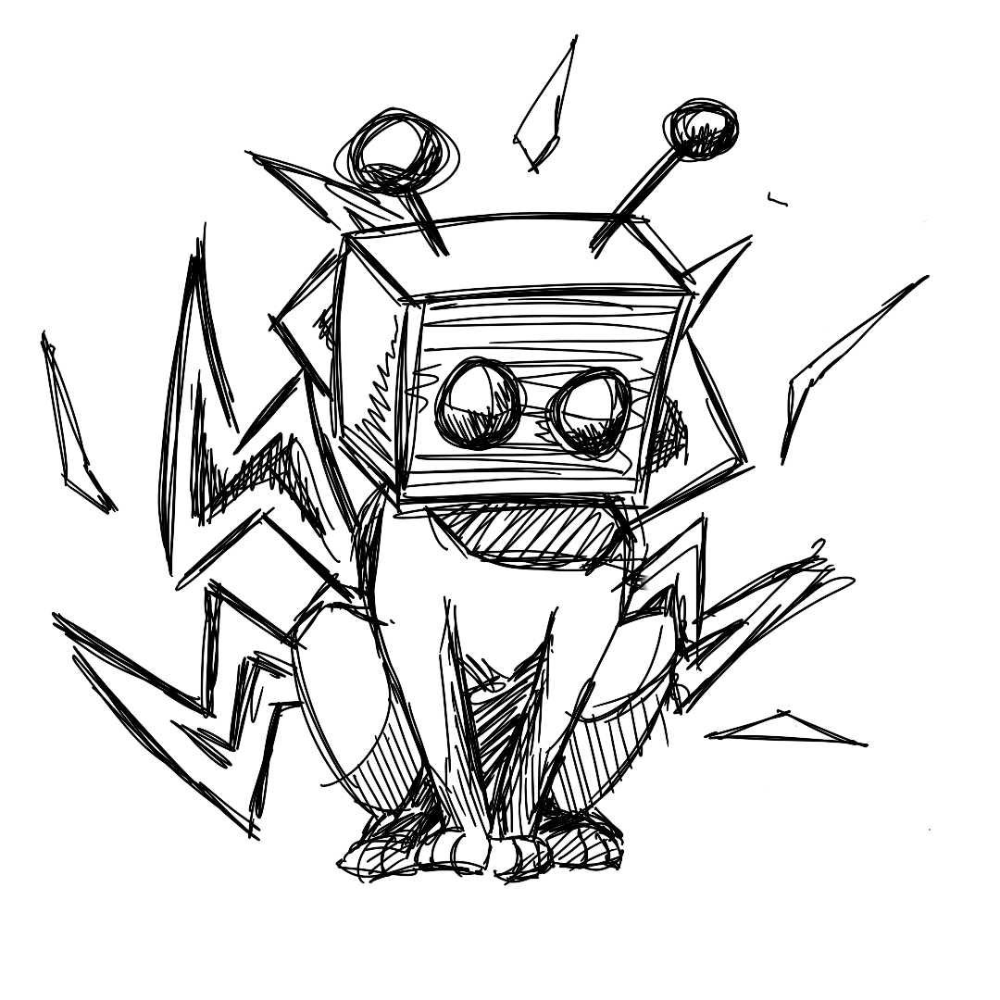
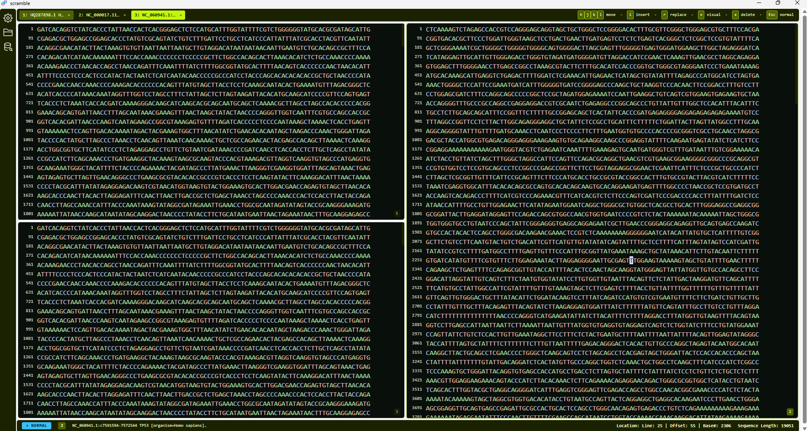

## Scramble
----

-----
### Project ongoing👷🛠️
### What is scra🫟mble
Scramble is a desktop application for working with nucleotide sequences. It is both a tool for organisation and storage of your own data but also allows for you to access publicly available data over the NCBI Datasets API. The first implementation will focus on storing your data locally making this an isolated application you can also run offline for increased security.

Scramble is prioritising a smooth workflow while still allowing for a high degree of flexibility to its user. This is also the reason why scramble aims to allow for a mouseless experience, using an expandend set of vim motions and pseudo in-app commandline features (searching an open file with /AGT or /"filename.fasta").

### Sneakpeak

#### Multipane Sequence View

#### Keyboard Movement

I apologise for the screenrecording quality🙇‍♂️. The application is thankfully not that slow.

### Disclaimer ⚠️

This project is a feature exploration fork of [scramble](https://github.com/PauMerr95/scramble) that  utilises AI coding to protype and test features that will eventually be ported to scramble. It is not a branch but a separate repo to clearly separate it due to the conflicts in project philosophy.

As a result this project will have more feature while also being more experimental than the main port of the application.

The main branch will mostly contain features that will stay, are stable and will eventuelly be reviewed and ported back - other branches are unsafe terrain.